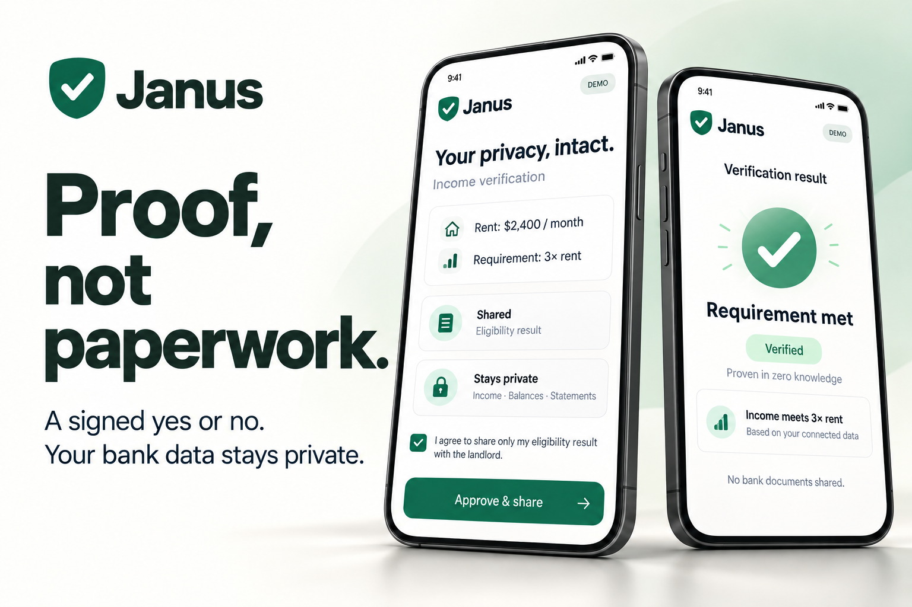

# Janus

**Prove what matters. Keep the rest private.**

Janus answers a narrow question—“Is income at least 3× rent?” or “Are you at least 18?”—without sending bank statements or ID images to the requester. Built for HackHarvard 2026 with Capital One Nessie and Photon messaging.

[CI](https://github.com/BorisHadjiev/Janus-HackHarvard-2026/actions/workflows/ci.yml) · [Demo portal](https://janus-hackharvard.onrender.com/) · [Threat model](docs/threat-model.md) · [Measured document accuracy](docs/document-accuracy.md)



*Illustrative product mockups. The live demo supports income verification and age 18+ checks.*

## HackHarvard tracks and sponsor integrations

- **Digital Trust: Fintech and Cybersecurity:** Janus reduces disclosure in income and age verification. A requester gets a signed eligibility answer, evidence strength and, for bank-backed income, a zero-knowledge proof instead of copies of sensitive documents.
- **Capital One — Best Use of Nessie:** the tenant service fetches demo bank deposits through Nessie and evaluates recurring income against the request's rent requirement. The demo distinguishes payroll from a one-time transfer.
- **Photon — Build a Messaging Agent with Photon 2.0:** Janus delivers the verification request through messaging and handles tenant replies. The demonstrated channel is iMessage.

These are the relevant categories on the [HackHarvard 2026 Devpost prize list](https://hackharvard2026.devpost.com/#prizes). Selecting a category on Devpost is separate from listing it here.

### Where Nessie is used

[`scripts/seed-nessie.ts`](scripts/seed-nessie.ts) creates the demo customers, accounts and deposits. [`tenant-app/lib/nessie.ts`](tenant-app/lib/nessie.ts) reads `GET /accounts/{id}/deposits`, and [`tenant-app/lib/income.ts`](tenant-app/lib/income.ts) evaluates recurring payers over the income window. Maya meets the example requirement. Leo's one-time $6,000 transfer does not turn his recurring income into a pass. Nessie is sandbox data, not access to a user's real Capital One account. The separate [bank signer](bank-signer/) supplies the demo attestation used by the income proof.

### Where Photon is used

[`messaging/src/photon.ts`](messaging/src/photon.ts) connects the tenant's messaging identity and sends the request through the Photon beta API or the Spectrum iMessage client, depending on the configured project. [`messaging/src/deliver.ts`](messaging/src/deliver.ts) sends the question and private consent link. The [inbound webhook](landlord-portal/app/api/photon/inbound/route.ts) and [`landlord-portal/lib/text-reply.ts`](landlord-portal/lib/text-reply.ts) handle YES/NO replies for the demo income flow. Age verification still requires opening the link, providing an ID and approving the disclosure. See [messaging setup](messaging/README.md) for credentials, channels and reply handling.

## What works

A requester creates a question and shares the consent link, optionally by Photon text. The tenant service reads bank data or uploaded documents, computes the answer, and signs it with Ed25519. The portal checks the signature, audience, question, expiry, one-time nonce and configured build trust before displaying the answer and evidence level. Requests and used nonces persist across restarts.

Income can come from demo deposits, Capital One Nessie, Plaid sandbox, or PDF/photo documents: pay stubs, bank statements, W-2s and 1040s. The bank calculation uses recurring payers and a median month to exclude one-time transfers. Document checks include arithmetic, freshness, PDF signatures/tamper signals and optional comparison with bank deposits.

Age checks read a license PDF417/AAMVA barcode, a passport/ID machine-readable zone with check digits, or front-of-card DOB text. A usable adult ID returns yes; a usable minor ID returns no; unreadable, expired or failed IDs are declined. Birth dates and exact ages stay out of the public report and claim.

The current product serves landlord/tenant requests. The same minimum-disclosure approach could support age gates for communities such as Discord or hotel check-in, reducing the copies of identity documents those services retain. Those integrations and production identity assurance are future work.

## Live demo

Open **[janus-hackharvard.onrender.com](https://janus-hackharvard.onrender.com/)** and create an income or Age 18+ request. The portal runs on Render. The current tenant service and demo bank signer run on the demo laptop, with a temporary tunnel for consent links, so that laptop and tunnel must stay running for approvals. A sleeping free Render instance may take time to start.

## Run locally

Use Node.js 20+ and npm.

```bash
git clone https://github.com/BorisHadjiev/Janus-HackHarvard-2026.git
cd Janus-HackHarvard-2026
npm run setup
npm run dev
```

Open the portal at http://localhost:3000. Create an income or Age 18+ request, open its tenant link (tenant app at http://localhost:3001; stand-in bank signer at http://localhost:3002), review the disclosure and approve. Default demo tenants are Maya (income yes at $2,400 rent / 3×) and Leo (no). Without messaging credentials, the portal displays and logs the link.

For age and income document examples:

```bash
npm run sample-docs
```

The git-ignored `sample-documents/` directory includes income examples, a signed test pay stub, edited examples and seven age images. `README.txt` describes each file. Age specimens include an adult license front/back with PDF417, a minor aged 17 years 11 months, an expired license, a valid UTO passport, an edited MRZ and a rotated/blurred JPEG. All carry large specimen labels, fictional issuers/names and grey silhouettes. Dates are relative to generation day; regenerate before a demo. The command also configures a local test PDF signer; restart the tenant service afterward.

## Privacy and trust boundaries

Document processing happens in the **tenant service**, using locally installed OCR models and barcode WASM. To keep source files on the tenant's machine, run that service there. Uploading to a hosted tenant service sends the files to its server; this is not browser-only processing. The requester portal receives the signed answer and coarse evidence metadata, not the uploaded files or bank transactions.

Income evidence is labeled bank, signed documents, documents confirmed by bank, or documents only / not independently verified. Every age claim uses `document_unverified`: a barcode and valid MRZ check digits do not authenticate a government issuer or the person presenting the image. State-signed mobile driver's licenses with selective disclosure are the intended production path.

Claims bind the answer to a question, audience and nonce. They use a pairwise subject and day-rounded issuance time to reduce correlation. The collusion simulation measures the fields it models; it does not establish protection from network, account or device tracking. Software build checks also do not provide hardware attestation or make a locally held signing key inaccessible to its owner.

## Zero-knowledge income proofs

Demo bank income answers include a real Noir/Barretenberg proof. The separate bank signer signs a salted Pedersen commitment to the deposit list; the tenant proves the recurring-income predicate over that private list, bound to the rent, multiple and one-time request code. The portal verifies both the bank attestation and the proof and checks that the answer matches. Deposit amounts and payer details stay private. `npm run dev` starts the signer on port 3002; `npm run keys` configures its key and the portal's `TRUSTED_BANK_KEYS`.

When trusted bank keys are configured, bank-strength claims require the proof. This protects against changing the answer or substituting deposits without a matching bank attestation. It relies on the bank signing accurate data. The demo signer is an unauthenticated stand-in; a production issuer must control the signing key and authenticate data access. Documents, age and the current Plaid path do not use this proof.

Change the circuit in `zk/circuit/src/main.nr`, then run `npm run compile:zk` and commit the generated artifact. Run `npm run smoke:zk` against the three local services to check missing or tampered proofs, bank signatures, request binding, result consistency and replay rejection. See [docs/zero-knowledge.md](docs/zero-knowledge.md) for setup, public inputs, limits and deployment requirements.

## Configuration

`npm run keys` creates local signing keys. Keep secrets in git-ignored `*/.env.local`; never commit or paste them into logs.

- **Nessie:** set `NESSIE_API_KEY` and the demo account mappings in `tenant-app/.env.local`. See [seeding script](scripts/seed-nessie.ts) for account setup.
- **Plaid:** set `PLAID_CLIENT_ID` and `PLAID_SECRET` in the tenant app; sandbox is the default.
- **Photon:** set `PHOTON_API_KEY`, `PHOTON_PROJECT_ID`, `PHOTON_SENDER_ID` and optionally `PHOTON_PLATFORM` in the portal. See [messaging documentation](messaging/README.md). Set `PHOTON_INBOUND_SECRET` before exposing the inbound webhook. Demo YES replies approve income requests; age requires ID upload and consent.
- **Build trust:** `npm run sign-manifest` signs the current tenant build and configures its trusted hash. Regenerate after code changes. `npm run sign-manifest -- --reset` returns to unsigned development mode; development defaults are not production assurance.

## Validate changes

```bash
npm test
npm run build
npm run smoke          # requires the portal, tenant app and bank signer running
npm run smoke:zk       # same three services
npm run collusion
npm run doc-accuracy
```

Smoke covers income yes/no, forged tokens, replay protection, an adult specimen through the full age flow, and replay of its exact signed claim. It skips age cleanly in checkouts without the ID reader. For alternate ports, set `PORTAL` and `TENANT` when invoking smoke.

Document accuracy generates a labeled synthetic income corpus and reports age outcomes separately for the seven specimens. A correct outcome is yes, no or decline as appropriate. CI compares income metrics with `main` on the same runner to account for platform-dependent OCR fonts, and requires every age outcome to match. Synthetic layouts do not establish accuracy on arbitrary real-world statements or IDs, nor do they demonstrate fraud resistance. `npm run doc-accuracy -- --people 30` expands the income corpus.

## Next steps

- Replace the stand-in bank signer with authenticated credentials issued by real banks.
- Use issuer-signed mobile driver's licenses for stronger age assurance and selective disclosure.
- Add organization policies, team access, bulk requests and integrations with existing platforms.
- Extend the question types to student status, residency and employment.

## Repository

- `shared/`: question/claim types, Ed25519 signing and verification, pairwise subjects.
- `zk/` and `bank-signer/`: income circuit, proof generation/verification and stand-in bank attestation.
- `tenant-app/`: consent, bank integrations, income evaluation, document/ID reading and local integrity checks.
- `landlord-portal/`: request creation, claim validation, durable request state and results.
- `messaging/`: Photon client and reply handling.
- `scripts/`: setup, specimens, smoke, accuracy and collusion checks.
- `docs/`: [age flow](docs/age-verification.md), [scanner work](docs/scanner-fixes.md), threat model and measurements.

Read [AGENTS.md](AGENTS.md) before contributing. Preserve the claim's minimum-disclosure contract, coordinate changes to shared types with Sam, and keep tests, builds and smoke green. The public deployment may lag repository changes; local validation is not evidence that a release has deployed.

The product is branded Janus. The public demo runs at https://janus-hackharvard.onrender.com/. Cryptographic issuer/workspace identifiers remain stable for signed-claim compatibility.
